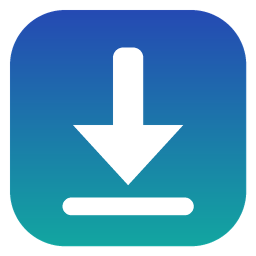

# UniFetcher for Windows

A personal, private video downloader for Windows, powered by [yt-dlp](https://github.com/yt-dlp/yt-dlp). It is the desktop companion to the UniFetcher Android app.

> **UniFetcher is based on [Parabolic](https://github.com/NickvisionApps/Parabolic) by Nickvision (Nicholas Logozzo and contributors).** Thank you to them for a great, open-source app. UniFetcher keeps Parabolic's MIT licence and copyright notice (see [LICENSE](LICENSE)). UniFetcher is an independent fork and is not supported by Nickvision; please don't report UniFetcher problems to the Parabolic project.

## Privacy

- No analytics, crash reporting, telemetry, ads or tracking — in the app or the browser extension.
- The only internet connections UniFetcher makes are: the sites you download from, the official yt-dlp and yt-dlp/FFmpeg-Builds GitHub releases (to keep them up to date), and this repository's Releases page (to check for UniFetcher updates).
- Settings and history stay on your PC, in UniFetcher's own folder under your user profile (`%APPDATA%\UniFetcher`). Downloads go only to the folder you choose.

## Features

Working now (inherited from Parabolic):
- Download video and audio from the thousands of sites yt-dlp supports
- Choose quality, format, subtitles, and save folder; queue several downloads
- Download history, playlists, and keeping yt-dlp up to date
- Small browser extension for Firefox and Chrome/Brave to send a page to UniFetcher

Being added (see [STATUS.md](STATUS.md) for progress):
- Automatic yt-dlp/ffmpeg updates (Nightly by default) with retry and roll-back
- Polite queue with pause on connection loss and external hard drive support
- A separate "UniFetcher" Firefox profile for site sessions, so nothing mixes with your main browser
- "Send all tabs to UniFetcher" and bulk import of 150+ links, with a clear end report
- Quality rule: best up to 1080p, prefer at least 720p, never re-encode

Not supported: DRM-protected sites (UniFetcher will say so clearly).

## Install

1. Open the [Releases page](https://github.com/Obamna1234/UniFetcher-Windows/releases).
2. Download `UniFetcher-<version>-Setup-x64.exe` (or `-arm64` for ARM PCs) and run it.
3. Windows may show "Windows protected your PC" because UniFetcher isn't code-signed. See [HOW_TO.md](HOW_TO.md#the-windows-protected-your-pc-warning).

Prefer not to install? Download the `Portable` zip, unzip it anywhere, and run `UniFetcher.bat`.

Beginner guide for everything (installing, updating, the extension, VPN, external drives, reporting bugs, releasing): [HOW_TO.md](HOW_TO.md).

## Building

Everything is built by GitHub Actions — no local setup needed. Every push runs the **Build** workflow (download the result from the run's *Artifacts*); pushing a tag like `v1.0.0` runs the **Release** workflow.
